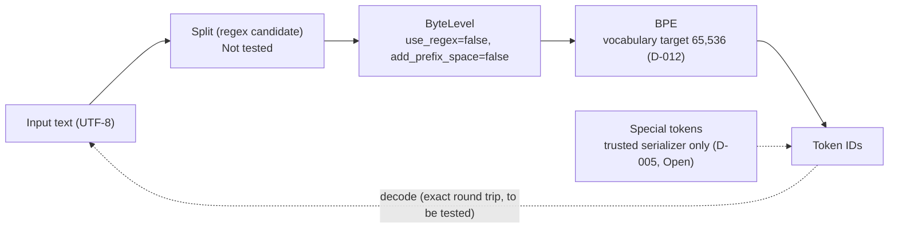
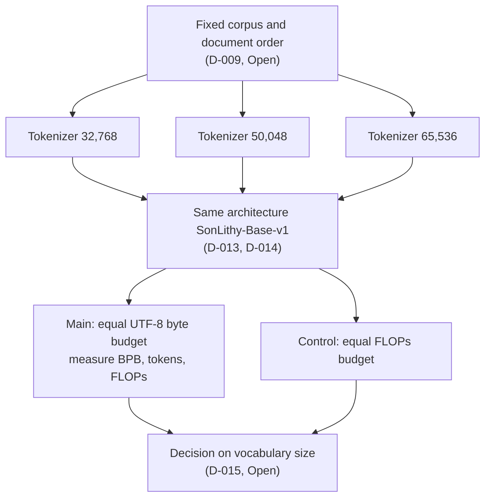

# 🧬 SonLithy-Tok

A byte-level BPE tokenizer for the SonLithy 3.5 language model
(architecture: SonLithy-Base-v1).

> **Status: design and scaffolding phase.** The tokenizer is not implemented yet,
> and no tests have been run against the target tokenizer library.

---

## Overview

SonLithy-Tok is the tokenizer for the SonLithy 3.5 family of open language models.
It converts text to token IDs and back. The design is built around four principles:

- **Byte-level BPE.** Any input can be represented as bytes, so unknown characters
  do not need a special fallback token.
- **Exact round trip.** The goal is `decode(encode(text)) == text` for the supported
  input domain. The exact contract is still being defined.
- **Safe special tokens.** Ordinary text that looks like a control token, such as
  `<|im_start|>`, must stay ordinary text. Control tokens are inserted only by
  trusted code.
- **Reproducibility.** Corpus manifests, seeds, configurations, and decisions are
  recorded so that every result can be traced.

## Pipeline (planned)

The diagram shows the intended design. Stages are not implemented yet; the status of
each stage is listed in [docs/decisions.md](docs/decisions.md).



## Experiment plan (planned)

The comparison of vocabulary sizes is designed, but no experiment has been run.



## Project status

| Area | Status |
|---|---|
| Algorithm: byte-level BPE | Chosen |
| Vocabulary size 65,536 | Working target; comparison with 32,768 and 50,048 pending (D-012, D-015) |
| Architecture SonLithy-Base-v1 (24 layers, d_model 768) | Approved in the decision register (D-013) |
| Weight tying and RoPE | Approved in the decision register (D-014) |
| Regex pre-tokenizer (`Split`) | Candidate; not tested on `tokenizers==0.23.3` |
| Corpus budget and sampling | Open (D-009) |
| Training pipeline | Not implemented |
| Evaluation tools | Not implemented |

"Approved" means the design decision was confirmed by the developer. It does not
mean the implementation has been tested. Verification status is stated per decision
in `docs/decisions.md`.

## Repository layout

```text
configs/            draft tokenizer configuration
docs/               specification, tokenization notes, training and evaluation
                    plans, decision register
src/sonlithy_tok/   package skeleton (no working logic yet)
scripts/            corpus audit, training, evaluation, benchmark (stubs)
tests/              unit and integration test structure
experiments/        planned comparison experiments
data/               data layout notes (data files are ignored by Git)
```

## Getting started (development)

Requirements: Python 3.10 or 3.11 (the versions used in CI).

```shell
python -m pip install -e ".[dev]"
pre-commit install
ruff check .
ruff format --check .
pytest
```

## Documentation

- [docs/SPECIFICATION.md](docs/SPECIFICATION.md): purpose, current draft
  configuration, open questions
- [docs/TOKENIZATION.md](docs/TOKENIZATION.md): pre-tokenization design and the
  regex candidate
- [docs/TRAINING.md](docs/TRAINING.md): training plan
- [docs/EVALUATION.md](docs/EVALUATION.md): evaluation plan
- [docs/decisions.md](docs/decisions.md): decision register with statuses and
  verification state

## Roadmap

1. Define the input contract: Unicode policy, normalization, and round-trip rules.
2. Validate the `Split` pre-tokenizer on the pinned `tokenizers` version.
3. Implement the BPE trainer and test it on a small synthetic corpus.
4. Build a corpus manifest with licences, deduplication, and held-out splits.
5. Run the vocabulary comparison (32,768 / 50,048 / 65,536) under a fixed protocol.
6. Publish the tokenizer artifact with a versioned schema.

## Contributing

Design changes should update `docs/decisions.md` together with the affected
specification. A decision is `Approved` only when it has been explicitly confirmed;
a value appearing in a configuration file does not make a decision approved.

## License

See the [LICENSE](LICENSE) file.
